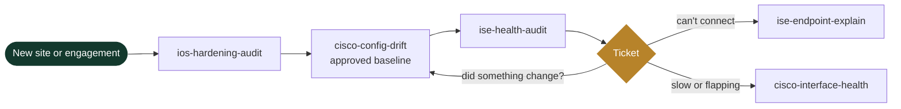

<picture>
  <source media="(prefers-color-scheme: dark)" srcset="assets/banner-dark.svg">
  
</picture>

<p align="center">CCNP Enterprise, Architecture and Design &nbsp;·&nbsp; CySA+ &nbsp;·&nbsp; Security+ &nbsp;·&nbsp; based in New York &nbsp;·&nbsp; open to roles in Germany, across Europe and in the US</p>

<p align="center">
  <a href="https://www.linkedin.com/in/arkadiy-ayrapetov-nyc/"></a>
  <a href="mailto:arkadiy@ayrapetov.co"></a>
  <a href="https://a-ayrapetov.github.io"></a>
</p>

<p align="center">
  
  
  
  
</p>

Fourteen years securing enterprise and industrial networks. I scope, design, build, automate and document, and I am strongest where security, network and automation meet. Everything public here is rewritten from scratch and carries no customer data.

**Hiring?** [What I do](#what-i-do) · [Recent field work](#recent-field-work) · [Contact](#contact)
&nbsp;&nbsp;|&nbsp;&nbsp;
**Engineer?** [Which tool, when](#which-tool-when) · [Try one in sixty seconds](#try-one-in-sixty-seconds-no-network-required) · [Playbooks](#how-i-work-playbooks)

## What I do

| Area | In practice |
|---|---|
| **OT/ICS security** | Security architecture for a major North American rail transit network: hundreds of stations, about 1,400 switches. About 30 security groups across train control, SCADA, fire alarm, elevators, fare collection and CCTV, mapped to IEC 62443, under the TSA rail security directives (the US counterpart to NIS2 and KRITIS). |
| **Identity and Zero Trust** | Cisco ISE 3.x design, upgrades and rescue, 802.1X EAP-TLS, closed-mode MAB, TrustSec, PKI. Took over a campus with broken authentication; 915 endpoints now run EAP-TLS across eight virtual networks. |
| **Visibility and detection** | Network TAPs on train control feeding two OT detection platforms, cut in during one overnight window with no service disruption. Traced 85 percent of daily alarming hosts in a flow analytics platform to ten rules and tuned them out. |
| **Automation** | Python AAA hardening on 6,000+ switches. A discovery sweep that found about 5,000 OT assets missing from every inventory. The tools below are the public, generic versions of this kind of work. |
| **Campus, WAN and data center** | SD-Access and Catalyst Center, Catalyst 9800 wireless, Meraki and SD-WAN migrations, Nexus vPC, Secure Firewall. |

Platforms I work in: Cisco ISE, Catalyst Center, SD-Access, Catalyst 9800, Meraki, Nexus, Secure Firewall, Secure Network Analytics, Gigamon, Nozomi, Darktrace, Python with Netmiko, PowerShell.

## Recent field work

Anonymized.

- Moved 25 security groups and 9 contracts from ISE to Catalyst Center Group-Based Access Control with zero failures.
- Upgraded a Catalyst Center cluster within 2.3.7, then to 3.2.3 in an overnight run that finished just after midnight.
- Showed that held uploads blamed on the network came from a saturated 10G dedicated cloud circuit, using controller interface history cross checked against the carrier's graphs. A larger circuit was approved the same day.
- Reproduced a controller provisioning fault that emptied the WLAN maps on a Catalyst 9800, under a five second watch with automatic restore.
- Fixed an EAP-TLS incident (ISE failure 22047) by adding UPN and URI subject alternative names to the MDM's SCEP user certificate profile.
- Built and run the knowledge base my engagements work from: one Cloudflare Worker, a sealed container per knowledge base, sign in through an allow list, every write versioned, a secret guard on writes, scheduled backups, and a deploy pipeline that smoke tests and rolls back. Every pull request gets an AI review that must quote the code behind each point.

## Which tool, when

| The situation | Run | What you get back |
|---|---|---|
| "Why did this laptop land in the wrong VLAN?" | [ise-endpoint-explain](https://github.com/a-ayrapetov/ise-endpoint-explain) | The live session plus an authentication timeline: switch and port, authorization profile, SGT, matched rule, and every failure reason in plain English |
| Change window tomorrow. Is ISE healthy? | [ise-health-audit](https://github.com/a-ayrapetov/ise-health-audit) | Nodes down, missing admin HA, system and trusted certificates expired or expiring within 30 and 60 days |
| "Did anyone touch the switches since the last approved state?" | [cisco-config-drift](https://github.com/a-ayrapetov/cisco-config-drift) | A baseline of every running-config and a clean diff of anything changed outside change control |
| "The network is slow" or a port keeps flapping | [cisco-interface-health](https://github.com/a-ayrapetov/cisco-interface-health) | Ports ranked by urgency: err-disabled, CRC, duplex mismatch, drops, resets, each with the likely cause and the next step |
| New site handover, or audit prep | [ios-hardening-audit](https://github.com/a-ayrapetov/ios-hardening-audit) | Every hardening gap per device with severity, the evidence line and the exact fix |
| A new or inherited Windows machine | [win-security-posture-audit](https://github.com/a-ayrapetov/win-security-posture-audit) | TPM, Secure Boot, Defender, BitLocker, firewall, startup items, drivers and hardware health in one report, plus a fix plan it does not apply |

## Try one in sixty seconds, no network required

Two of the tools work entirely offline on text you already have.

```bash
# Paste "show interfaces" output from one switch or fifty; get the ports that need attention, ranked
pip install git+https://github.com/a-ayrapetov/cisco-interface-health
ifhealth show_interfaces.txt

# Point it at a folder of running-configs; get every hardening gap with the fix
pip install git+https://github.com/a-ayrapetov/ios-hardening-audit
ios-harden configs/*.cfg --csv findings.csv
```

## How they fit together



Day one is a hardening audit and a drift baseline. ISE health runs before anything can take authentication down. After that, every "can't connect" goes through ise-endpoint-explain and every "it's slow" through cisco-interface-health.

## How I work: playbooks

Method notes from the same engagements, with no customer in them.

| Playbook | When to read it |
|---|---|
| [AI assistant, human at the keyboard](playbooks/ai-assisted-network-operations.md) | You want an AI assistant on production network work without it guessing or touching a device |
| [Closed-mode MAB, one site at a time](playbooks/closed-mode-mab-site-rollout.md) | You are closing access ports for devices that cannot do 802.1X |
| [NDR alarm noise reduction loop](playbooks/ndr-alarm-noise-reduction-loop.md) | Your flow analytics platform alarms all day and nobody looks any more |
| [Production change by script](playbooks/gated-production-change.md) | A change has to reach a production device and the way back must be ready before the first line goes in |
| [The script contract](playbooks/script-contract.md) | You write automation that someone else runs on a host you cannot reach |
| [Two sources and a proof](playbooks/two-sources-and-a-proof.md) | Someone asks "how much", "where" or "who" about a network and the answer will drive a decision |

The gates and proofs those two describe are code: [netops_gates_and_proofs.py](playbooks/templates/netops_gates_and_proofs.py), standard library only, 35 tests.

<details>
<summary><b>Build status</b></summary>

| Tool | CI | Language |
|---|---|---|
| ise-endpoint-explain | [](https://github.com/a-ayrapetov/ise-endpoint-explain/actions) | Python |
| ise-health-audit | [](https://github.com/a-ayrapetov/ise-health-audit/actions) | Python |
| cisco-config-drift | [](https://github.com/a-ayrapetov/cisco-config-drift/actions) | Python |
| cisco-interface-health | [](https://github.com/a-ayrapetov/cisco-interface-health/actions) | Python |
| ios-hardening-audit | [](https://github.com/a-ayrapetov/ios-hardening-audit/actions) | Python |
| win-security-posture-audit | [](https://github.com/a-ayrapetov/win-security-posture-audit/actions) | PowerShell |

</details>

<details>
<summary><b>Rules every tool follows</b></summary>

**Read-only by default.** Show commands and GET calls. Nothing is pushed to a device unless the README says so in its first line.

**No stored credentials.** Prompted at runtime or read from the environment, never written to disk, never logged.

**No real networks in the repo.** Sample data uses RFC 5737 documentation addresses only.

**Gated CI.** Every push runs a secret scan and fails on any private RFC 1918 address. The same gate is what keeps customer data out of this account.

**Evidence over opinion.** Each tool prints the lines that prove its own result, so the output can go straight into a change record.

New tools start from [repo-template](https://github.com/a-ayrapetov/repo-template) and land here once they pass review.

</details>

## Contact

Open to architect and senior engineer roles in network and OT security, in Germany, across Europe and in the US, and to consulting work.
Email [arkadiy@ayrapetov.co](mailto:arkadiy@ayrapetov.co) · [LinkedIn](https://www.linkedin.com/in/arkadiy-ayrapetov-nyc/) · field notes on network and OT security at [a-ayrapetov.github.io](https://a-ayrapetov.github.io)
