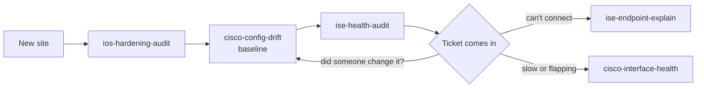

# Arkadiy Ayrapetov

**Cyber Security Architect.** 13+ years in enterprise and OT network security: Cisco ISE, TrustSec, SD-Access, Catalyst Center, 802.1X, RADIUS and TACACS+, and segmentation for industrial and life-science environments. CCNP Enterprise.

These are the tools I actually reach for on engagements, rewritten client-neutral so anyone can run them.

## When I reach for which tool

| When this happens | I run | What comes back |
|---|---|---|
| "Why did this laptop land in the wrong VLAN?" | [ise-endpoint-explain](https://github.com/a-ayrapetov/ise-endpoint-explain) | Live session plus an authentication timeline: switch and port, authorization profile, SGT, matched rule, and every failure reason in plain English |
| Before a change window or an audit: is ISE healthy? | [ise-health-audit](https://github.com/a-ayrapetov/ise-health-audit) | Nodes down, missing admin HA, system and trusted certificates expired or expiring in 30 or 60 days |
| "Did anything change on the switches since the last approved state?" | [cisco-config-drift](https://github.com/a-ayrapetov/cisco-config-drift) | An approved baseline of every running-config and a clean diff of anything changed outside change control |
| "The network is slow" or a port keeps flapping | [cisco-interface-health](https://github.com/a-ayrapetov/cisco-interface-health) | Ports ranked by urgency: err-disabled, CRC, duplex mismatch, drops, resets, each with the likely cause and next step |
| New site handover, or audit prep | [ios-hardening-audit](https://github.com/a-ayrapetov/ios-hardening-audit) | Every hardening gap per device with severity, the evidence line and the exact fix |
| A new or inherited Windows machine | [win-security-posture-audit](https://github.com/a-ayrapetov/win-security-posture-audit) | TPM, Secure Boot, Defender, BitLocker, firewall, startup items, drivers and hardware health in one report |

## How they fit together on an engagement

Day one is a hardening audit and a drift baseline, then ISE health before anything breaks authentication. After that, every "can't connect" goes through ise-endpoint-explain and every "it's slow" through cisco-interface-health.

## Rules every tool follows

- **Read-only by default.** Show commands and GET calls; nothing is pushed unless the README says so.
- **No stored credentials.** Prompted at runtime or read from the environment, never written to disk.
- **No real networks in the repo.** Sample data uses RFC 5737 documentation addresses only.
- **Gated CI.** Every push runs a secret scan and fails on any private RFC 1918 address.

New tools start from [repo-template](https://github.com/a-ayrapetov/repo-template) and are added here once they pass review.
