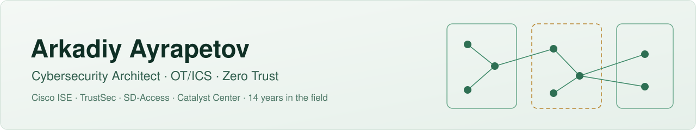
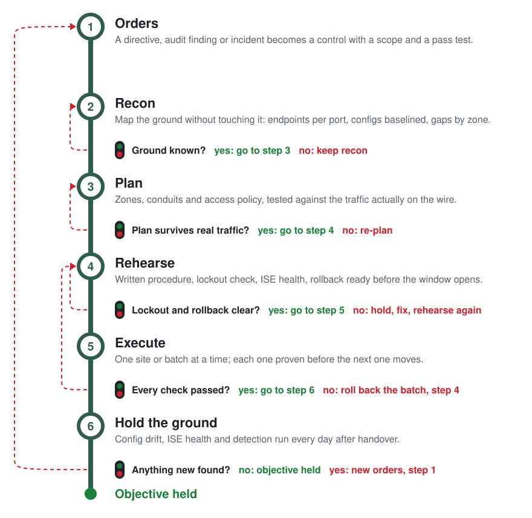

<picture>
  <source media="(prefers-color-scheme: dark)" srcset="assets/banner-dark.svg">
  
</picture>

<p align="center">CCNP Enterprise, Architecture and Design &nbsp;·&nbsp; CySA+ &nbsp;·&nbsp; Security+ &nbsp;·&nbsp; based in New York &nbsp;·&nbsp; open to roles in Germany, across Europe and in the US</p>

<p align="center">
  <a href="https://www.linkedin.com/in/arkadiy-ayrapetov-nyc/"></a>
  <a href="mailto:arkadiy@ayrapetov.co"></a>
  <a href="https://a-ayrapetov.github.io"></a>
</p>

<p align="center">
  
  
  
  
</p>

Fourteen years securing enterprise and industrial networks. I scope, design, build, automate and document, and I am strongest where security, network and automation meet. Everything public here is rewritten from scratch and carries no customer data.

**Hiring?** [What I do](#what-i-do) · [Recent field work](#recent-field-work) · [Field notes](#field-notes) · [Contact](#contact)
&nbsp;&nbsp;|&nbsp;&nbsp;
**Hands-on?** [Which tool, when](#which-tool-when) · [Try one in sixty seconds](#try-one-in-sixty-seconds-no-network-required) · [Playbooks](#how-i-work-playbooks)

## What I do

| Area | In practice |
|---|---|
| **OT/ICS security** | Security architecture for the operational networks of a large US transit agency: identity, segmentation and detection across train control, SCADA, fire alarm, elevators, fare collection and CCTV, with security groups mapped to IEC 62443 under the TSA rail security directives. |
| **Identity and Zero Trust** | Cisco ISE 3.x design, upgrades and rescue, 802.1X EAP-TLS, closed-mode MAB, TrustSec, PKI. Took over a biotech company's campus network and made it stable: 915 endpoints on certificate-based EAP-TLS across eight virtual networks. |
| **Visibility and detection** | Network TAPs on train control feeding two OT detection platforms, cut in during one overnight window with no service disruption. Traced 85 percent of daily alarming hosts in a flow analytics platform to ten rules, then worked them down by classifying the hosts behind them instead of switching rules off. |
| **Automation** | Python AAA hardening on 6,000+ switches. Asset discovery that found thousands of OT devices missing from every inventory. The tools below are the public, generic versions of this kind of work. |
| **Networks and telecommunications** | SD-Access and Catalyst Center, Catalyst 9800 wireless, Nexus vPC, Secure Firewall. Moved a state agency's 17 sites to SD-WAN, dual stack, with BGP to Azure. Leading a county's phone system refresh: Unified Communications Manager and Unity 11.5 to 15, 9 PRI circuits moving to SIP on two CUBE gateways. BGP over AWS Direct Connect for a genomics company's lab data. |
| **Requirements and planning** | Requirements turned into controls and evidence. Level of effort, statements of work and bills of material checked before the order. Phased plans with a decision point and a rollback at every step, such as a data center switch replacement under a live vSAN stretch cluster, moved three server links at a time so no server ever drops. |

Platforms I work in: Cisco ISE, Catalyst Center, SD-Access, Catalyst 9800, Meraki, Nexus, Secure Firewall, Secure Network Analytics, Gigamon, Nozomi, Darktrace, Python with Netmiko, PowerShell.

## Where I work: IT to OT, level by level

The Purdue model from the enterprise down to the field, and what I do at each level. [Clickable version](https://a-ayrapetov.github.io/purdue.html).

```mermaid
%%{init: {"flowchart": {"rankSpacing": 30, "nodeSpacing": 20}}}%%
flowchart LR
  L4["<b>Levels 4 and 5: Enterprise IT</b><br/>ISE identity and Zero Trust<br/>SD-Access, Catalyst Center<br/>firewalls, cloud links"]
  L35["<b>Level 3.5: OT DMZ</b><br/>jump hosts, patch relay<br/>historian replica<br/>remote access with MFA"]
  L3["<b>Level 3: Operations</b><br/>control center servers<br/>TrustSec security groups<br/>NDR sensors"]
  L2["<b>Level 2: Supervisory</b><br/>HMIs, station systems<br/>closed-mode MAB<br/>for devices without 802.1X"]
  L1["<b>Levels 1 and 0: Control and field</b><br/>train control, PLCs, signals<br/>agentless, passive TAPs<br/>data diode out"]
  L4 -->|conduit:<br/>firewall, jump host| L35
  L35 -->|conduit:<br/>firewall, monitoring| L3
  L3 <-->|security groups,<br/>MAB| L2
  L2 ~~~ L1
  L1 -.->|one way out,<br/>data diode| L2

  style L4 fill:#1f6feb,color:#fff,stroke:none
  style L35 fill:#6e40c9,color:#fff,stroke:none
  style L3 fill:#1a7f37,color:#fff,stroke:none
  style L2 fill:#1a7f37,color:#fff,stroke:none
  style L1 fill:#cf222e,color:#fff,stroke:none
```



| Level | What I do there | Tools |
|---|---|---|
| 4 and 5, enterprise IT | ISE identity and Zero Trust, SD-Access, Catalyst Center, firewalls, cloud links | [ise-endpoint-explain](https://github.com/a-ayrapetov/ise-endpoint-explain), [ise-health-audit](https://github.com/a-ayrapetov/ise-health-audit), [cisco-interface-health](https://github.com/a-ayrapetov/cisco-interface-health) |
| 3.5, OT DMZ | Jump hosts, patch relay, historian replica, vendor access with MFA; every conduit checked against real traffic | [ot-zone-conduit-check](https://github.com/a-ayrapetov/ot-zone-conduit-check) |
| 3, operations | Security groups across train control, SCADA, fire alarm, elevators, fare collection and CCTV, mapped to IEC 62443; NDR sensors | [ndr-coverage-map](https://github.com/a-ayrapetov/ndr-coverage-map), [cisco-config-drift](https://github.com/a-ayrapetov/cisco-config-drift) |
| 2, supervisory | Closed-mode MAB for devices that cannot run 802.1X, AAA hardening, asset discovery | [ot-asset-inventory](https://github.com/a-ayrapetov/ot-asset-inventory), [aaa-lockout-check](https://github.com/a-ayrapetov/aaa-lockout-check), [ios-hardening-audit](https://github.com/a-ayrapetov/ios-hardening-audit) |
| 1 and 0, control and field | Safety systems stay agentless; passive TAPs, data diode out | [ndr-coverage-map](https://github.com/a-ayrapetov/ndr-coverage-map) |

## How the work fits together

Every engagement runs on the same six steps. Each step ends at a gate, and the work moves on only when the gate's answer is yes. A no sends it back along the red line to the step named on it, so nothing reaches production on hope.

<p align="center"><a href="https://a-ayrapetov.github.io/workflow/"><b>Open the full-screen version</b></a>: walk it step by step, see the proof each step leaves behind, and follow two worked examples.</p>

<a href="https://a-ayrapetov.github.io/workflow/">
<picture>
  <source media="(prefers-color-scheme: dark)" srcset="assets/workflow-dark.svg">
  
</picture>
</a>

| Step | What happens | Gate to move on | Tools and playbooks |
|---|---|---|---|
| **1. Requirement** | The ask (a directive, an audit finding, an incident, a client request) becomes a control with a scope and a pass condition. | None: straight to step 2. | requirements-trace (being built), [Two sources and a proof](playbooks/two-sources-and-a-proof.md) |
| **2. Assess** | Endpoints per switch port from offline show output, every running-config baselined and audited, gaps listed per zone. | Assets and gaps known? No: keep assessing. | [ot-asset-inventory](https://github.com/a-ayrapetov/ot-asset-inventory), [ios-hardening-audit](https://github.com/a-ayrapetov/ios-hardening-audit), [cisco-config-drift](https://github.com/a-ayrapetov/cisco-config-drift) |
| **3. Design** | Zones and conduits, 802.1X or closed-mode MAB, TrustSec groups and contracts, replayed against observed flows until nothing legitimate breaks. | Holds on real traffic? No: redesign. | [ot-zone-conduit-check](https://github.com/a-ayrapetov/ot-zone-conduit-check), [Closed-mode MAB, one site at a time](playbooks/closed-mode-mab-site-rollout.md) |
| **4. Prepare the change** | A procedure with pre-checks, commands, verification and rollback; a lockout check; ISE health before the window; a script that stops on the first failed proof. | Lockout and rollback clear? No: hold, fix, check again. | [aaa-lockout-check](https://github.com/a-ayrapetov/aaa-lockout-check), [ise-health-audit](https://github.com/a-ayrapetov/ise-health-audit), [Production change by script](playbooks/gated-production-change.md), [The script contract](playbooks/script-contract.md) |
| **5. Deliver** | One batch at a time (a site, a set of ports or switches); each batch is proven before the next one starts. | Every proof passed? No: roll the batch back and return to step 4. | [ise-endpoint-explain](https://github.com/a-ayrapetov/ise-endpoint-explain), [cisco-interface-health](https://github.com/a-ayrapetov/cisco-interface-health), [cisco-config-drift](https://github.com/a-ayrapetov/cisco-config-drift) |
| **6. Operate and defend** | Drift against the approved state, ISE health and certificate expiry, detection tuned by classifying the hosts behind the alarms. | Any finding? Yes: it becomes a new requirement, back to step 1. No: in service. | [cisco-config-drift](https://github.com/a-ayrapetov/cisco-config-drift), [ise-health-audit](https://github.com/a-ayrapetov/ise-health-audit), [ise-endpoint-explain](https://github.com/a-ayrapetov/ise-endpoint-explain), [ndr-coverage-map](https://github.com/a-ayrapetov/ndr-coverage-map), [NDR alarm noise reduction loop](playbooks/ndr-alarm-noise-reduction-loop.md) |

## Recent field work

Anonymized.

- Moved 25 security groups and 9 contracts from ISE to Catalyst Center Group-Based Access Control with zero failures.
- Upgraded a Catalyst Center cluster within 2.3.7, then to 3.2.3 in an overnight run that finished just after midnight.
- Showed that held uploads blamed on the network came from a saturated 10G dedicated cloud circuit, using controller interface history cross checked against the carrier's graphs. A larger circuit was approved the same day.
- Reproduced a controller provisioning fault that emptied the WLAN maps on a Catalyst 9800, under a five second watch with automatic restore.
- Fixed an EAP-TLS incident (ISE failure 22047) by adding UPN and URI subject alternative names to the MDM's SCEP user certificate profile.
- Built and run the knowledge base my engagements work from: one Cloudflare Worker, a sealed container per knowledge base, sign in through an allow list, every write versioned, a secret guard on writes, scheduled backups, and a deploy pipeline that smoke tests and rolls back.

## Which tool, when

| The situation | Run | What you get back |
|---|---|---|
| "What is on this OT network?" and nobody may scan it | [ot-asset-inventory](https://github.com/a-ayrapetov/ot-asset-inventory) | Endpoints per switch port from ARP, MAC, interface and CDP/LLDP output, hidden switches and MACs with no IP flagged, and a diff of new, gone and moved devices between runs |
| Moving switch logins to ISE TACACS+ tomorrow | [aaa-lockout-check](https://github.com/a-ayrapetov/aaa-lockout-check) | Every AAA shape in the config that can lock you out: no working fallback, console authorization, undefined lists, a dead source interface, a management VRF mismatch |
| "Why did this laptop land in the wrong VLAN?" | [ise-endpoint-explain](https://github.com/a-ayrapetov/ise-endpoint-explain) | The live session plus an authentication timeline: switch and port, authorization profile, SGT, matched rule, and every failure reason in plain English |
| Change window tomorrow. Is ISE healthy? | [ise-health-audit](https://github.com/a-ayrapetov/ise-health-audit) | Nodes down, missing admin HA, system and trusted certificates expired or expiring within 30 and 60 days |
| "Did anyone touch the switches since the last approved state?" | [cisco-config-drift](https://github.com/a-ayrapetov/cisco-config-drift) | A baseline of every running-config and a clean diff of anything changed outside change control |
| "The network is slow" or a port keeps flapping | [cisco-interface-health](https://github.com/a-ayrapetov/cisco-interface-health) | Ports ranked by urgency: err-disabled, CRC, duplex mismatch, drops, resets, each with the likely cause and the next step |
| New site handover, or audit prep | [ios-hardening-audit](https://github.com/a-ayrapetov/ios-hardening-audit) | Every hardening gap per device with severity, the evidence line and the exact fix |
| A new or inherited Windows machine | [win-security-posture-audit](https://github.com/a-ayrapetov/win-security-posture-audit) | TPM, Secure Boot, Defender, BitLocker, firewall, startup items, drivers and hardware health in one report, plus a fix plan it does not apply |

## Try one in sixty seconds, no network required

Four of the tools work entirely offline on text you already have. Three of them:

```bash
# Paste "show interfaces" output from one switch or fifty; get the ports that need attention, ranked
pip install git+https://github.com/a-ayrapetov/cisco-interface-health
ifhealth show_interfaces.txt

# Point it at a folder of running-configs; get every hardening gap with the fix
pip install git+https://github.com/a-ayrapetov/ios-hardening-audit
ios-harden configs/*.cfg --csv findings.csv

# Same folder of configs; find what would lock you out of a TACACS+ change before you make it
pip install git+https://github.com/a-ayrapetov/aaa-lockout-check
aaa-lockout-check "configs/*.cfg"
```

## How I work: playbooks

Method notes from the same engagements, with no customer in them.

| Playbook | When to read it |
|---|---|
| [Closed-mode MAB, one site at a time](playbooks/closed-mode-mab-site-rollout.md) | You are closing access ports for devices that cannot do 802.1X |
| [NDR alarm noise reduction loop](playbooks/ndr-alarm-noise-reduction-loop.md) | Your flow analytics platform alarms all day and nobody looks any more |
| [Production change by script](playbooks/gated-production-change.md) | A change has to reach a production device and the way back must be ready before the first line goes in |
| [The script contract](playbooks/script-contract.md) | You write automation that someone else runs on a host you cannot reach |
| [Two sources and a proof](playbooks/two-sources-and-a-proof.md) | Someone asks "how much", "where" or "who" about a network and the answer will drive a decision |

The gates and proofs those two describe are code: [netops_gates_and_proofs.py](playbooks/templates/netops_gates_and_proofs.py), standard library only, 35 tests.

<details>
<summary><b>Build status</b></summary>

| Tool | CI | Language |
|---|---|---|
| ise-endpoint-explain | [](https://github.com/a-ayrapetov/ise-endpoint-explain/actions) | Python |
| ise-health-audit | [](https://github.com/a-ayrapetov/ise-health-audit/actions) | Python |
| cisco-config-drift | [](https://github.com/a-ayrapetov/cisco-config-drift/actions) | Python |
| cisco-interface-health | [](https://github.com/a-ayrapetov/cisco-interface-health/actions) | Python |
| ios-hardening-audit | [](https://github.com/a-ayrapetov/ios-hardening-audit/actions) | Python |
| ot-asset-inventory | [](https://github.com/a-ayrapetov/ot-asset-inventory/actions) | Python |
| aaa-lockout-check | [](https://github.com/a-ayrapetov/aaa-lockout-check/actions) | Python |
| win-security-posture-audit | [](https://github.com/a-ayrapetov/win-security-posture-audit/actions) | PowerShell |

</details>

<details>
<summary><b>Rules every tool follows</b></summary>

**Read-only by default.** Show commands and GET calls. Nothing is pushed to a device unless the README says so in its first line.

**No stored credentials.** Prompted at runtime or read from the environment, never written to disk, never logged.

**No real networks in the repo.** Sample data uses RFC 5737 documentation addresses only.

**Gated CI.** Every push runs a secret scan and fails on any private RFC 1918 address. The same gate is what keeps customer data out of this account.

**Evidence over opinion.** Each tool prints the lines that prove its own result, so the output can go straight into a change record.

New tools start from [repo-template](https://github.com/a-ayrapetov/repo-template) and land here once they pass review.

</details>

## Field notes

Longer write-ups of the same work on [a-ayrapetov.github.io](https://a-ayrapetov.github.io):

- [Inventory an OT network without sending it a single packet](https://a-ayrapetov.github.io/2026/11/13/passive-ot-asset-inventory.html)
- [Moving switches to ISE TACACS+ without locking yourself out](https://a-ayrapetov.github.io/2026/11/13/tacacs-migration-without-lockouts.html)
- [Closing access ports on industrial switches, one port at a time](https://a-ayrapetov.github.io/2026/11/13/closed-mode-mab-one-port-at-a-time.html)
- [Cutting NDR alarm noise without going blind](https://a-ayrapetov.github.io/2026/11/13/ndr-alarm-noise-without-going-blind.html)
- [An AI assistant on a production network that never gets a session](https://a-ayrapetov.github.io/2026/11/13/ai-assistant-that-never-touches-the-network.html)
- [When TrustSec looks like a routing problem](https://a-ayrapetov.github.io/2026/10/07/trustsec-looks-like-routing.html)

## Contact

Open to architect roles in network and OT security, in Germany, across Europe and in the US, and to consulting work.
Email [arkadiy@ayrapetov.co](mailto:arkadiy@ayrapetov.co) · [LinkedIn](https://www.linkedin.com/in/arkadiy-ayrapetov-nyc/) · field notes on network and OT security at [a-ayrapetov.github.io](https://a-ayrapetov.github.io)
