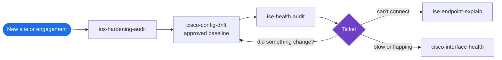

<h1 align="center">Arkadiy Ayrapetov</h1>
<p align="center"><b>Cyber Security Architect</b> &nbsp;·&nbsp; Cisco ISE, TrustSec, SD-Access, Catalyst Center &nbsp;·&nbsp; OT and regulated environments &nbsp;·&nbsp; CCNP Enterprise</p>

<p align="center">
  
  
  
  
</p>

Thirteen years of making network access control and segmentation actually hold in production: 802.1X and MAB rollouts, TrustSec policy, ISE at scale, campus fabrics, and industrial networks where availability comes first. The tools here are the ones I reach for on real engagements, rewritten so they carry no customer and anyone can run them.

## Which tool, when

| The situation | Run | What you get back |
|---|---|---|
| "Why did this laptop land in the wrong VLAN?" | [ise-endpoint-explain](https://github.com/a-ayrapetov/ise-endpoint-explain) | The live session plus an authentication timeline: switch and port, authorization profile, SGT, matched rule, and every failure reason in plain English |
| Change window tomorrow. Is ISE healthy? | [ise-health-audit](https://github.com/a-ayrapetov/ise-health-audit) | Nodes down, missing admin HA, system and trusted certificates expired or expiring within 30 and 60 days |
| "Did anyone touch the switches since the last approved state?" | [cisco-config-drift](https://github.com/a-ayrapetov/cisco-config-drift) | A baseline of every running-config and a clean diff of anything changed outside change control |
| "The network is slow" or a port keeps flapping | [cisco-interface-health](https://github.com/a-ayrapetov/cisco-interface-health) | Ports ranked by urgency: err-disabled, CRC, duplex mismatch, drops, resets, each with the likely cause and the next step |
| New site handover, or audit prep | [ios-hardening-audit](https://github.com/a-ayrapetov/ios-hardening-audit) | Every hardening gap per device with severity, the evidence line and the exact fix |
| A new or inherited Windows machine | [win-security-posture-audit](https://github.com/a-ayrapetov/win-security-posture-audit) | TPM, Secure Boot, Defender, BitLocker, firewall, startup items, drivers and hardware health in one report, plus a fix plan it does not apply |

## Try one in sixty seconds, no network required

Two of the tools work entirely offline on text you already have.

```bash
# Paste "show interfaces" output from one switch or fifty; get the ports that need attention, ranked
pip install cisco-interface-health
ifhealth show_interfaces.txt

# Point it at a folder of running-configs; get every hardening gap with the fix
pip install ios-hardening-audit
ios-harden configs/*.cfg --csv findings.csv
```

## How they fit together



Day one is a hardening audit and a drift baseline. ISE health runs before anything can take authentication down. After that, every "can't connect" goes through ise-endpoint-explain and every "it's slow" through cisco-interface-health.

## Build status

| Tool | CI | Language |
|---|---|---|
| ise-endpoint-explain | [](https://github.com/a-ayrapetov/ise-endpoint-explain/actions) | Python |
| ise-health-audit | [](https://github.com/a-ayrapetov/ise-health-audit/actions) | Python |
| cisco-config-drift | [](https://github.com/a-ayrapetov/cisco-config-drift/actions) | Python |
| cisco-interface-health | [](https://github.com/a-ayrapetov/cisco-interface-health/actions) | Python |
| ios-hardening-audit | [](https://github.com/a-ayrapetov/ios-hardening-audit/actions) | Python |
| win-security-posture-audit | [](https://github.com/a-ayrapetov/win-security-posture-audit/actions) | PowerShell |

## How I work: playbooks

Method notes from the same engagements, with no customer in them.

| Playbook | When to read it |
|---|---|
| [AI assistant, human at the keyboard](playbooks/ai-assisted-network-operations.md) | You want an AI assistant on production network work without it guessing or touching a device |
| [Closed-mode MAB, one site at a time](playbooks/closed-mode-mab-site-rollout.md) | You are closing access ports for devices that cannot do 802.1X |
| [NDR alarm noise reduction loop](playbooks/ndr-alarm-noise-reduction-loop.md) | Your flow analytics platform alarms all day and nobody looks any more |
| [The script contract](playbooks/script-contract.md) | You write automation that someone else runs on a host you cannot reach |
| [Two sources and a proof](playbooks/two-sources-and-a-proof.md) | Someone asks "how much", "where" or "who" about a network and the answer will drive a decision |

The gates and proofs those two describe are code: [netops_gates_and_proofs.py](playbooks/templates/netops_gates_and_proofs.py), standard library only, 35 tests.

## Recent field work

Anonymized.

- Moved 25 security groups and 9 contracts from ISE to Catalyst Center Group-Based Access Control with zero failures.
- Upgraded a Catalyst Center cluster within 2.3.7, then to 3.2.3 in an overnight run that finished just after midnight.
- Showed that held uploads blamed on the network came from a saturated 10G dedicated cloud circuit, using controller interface history cross checked against the carrier's graphs. A larger circuit was approved the same day.
- Reproduced a controller provisioning fault that emptied the WLAN maps on a Catalyst 9800, under a five second watch with automatic restore.
- Fixed an EAP-TLS incident (ISE failure 22047) by adding UPN and URI subject alternative names to the MDM's SCEP user certificate profile.
- Built and run the knowledge base my engagements work from: one Cloudflare Worker, a sealed container per knowledge base, sign in through an allow list, every write versioned, a secret guard on writes, scheduled backups, and a deploy pipeline that smoke tests and rolls back.

## Rules every tool follows

**Read-only by default.** Show commands and GET calls. Nothing is pushed to a device unless the README says so in its first line.

**No stored credentials.** Prompted at runtime or read from the environment, never written to disk, never logged.

**No real networks in the repo.** Sample data uses RFC 5737 documentation addresses only.

**Gated CI.** Every push runs a secret scan and fails on any private RFC 1918 address. The same gate is what keeps customer data out of this account.

**Evidence over opinion.** Each tool prints the lines that prove its own result, so the output can go straight into a change record.

New tools start from [repo-template](https://github.com/a-ayrapetov/repo-template) and land here once they pass review.
